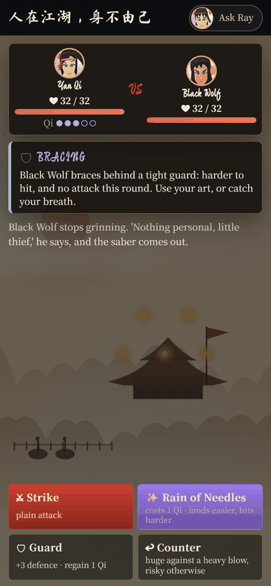
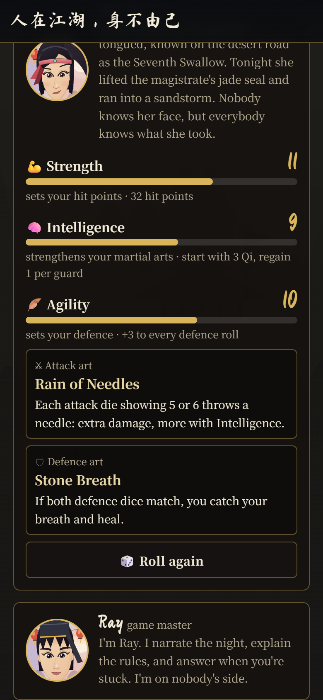
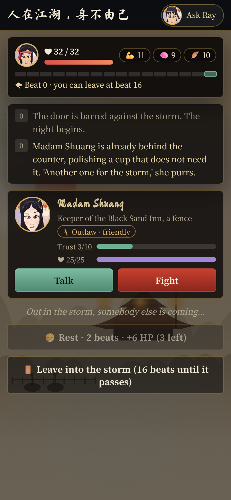
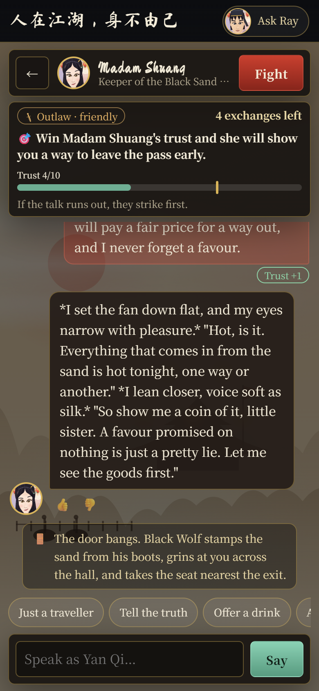
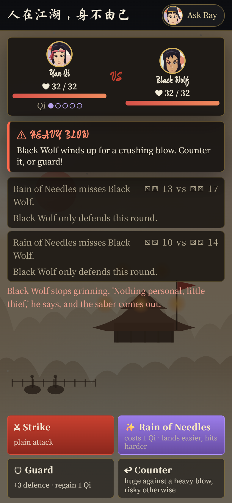

# 人在江湖，身不由己 · Helpless in the Jianghu

[](https://github.com/Rayjiao123/jiang-hu-game/actions/workflows/tests.yml)

A dark Song-dynasty wuxia survival game you can finish in five minutes, in **English, 中文 and ไทย**. You are a thief hiding in an inn during a sandstorm.
Seven AI-voiced characters walk in one by one, and each can be talked down or fought. Most players die.

### [▶ Play it: jiang-hu-game-production.up.railway.app](https://jiang-hu-game-production.up.railway.app)

Best on a phone. Pick a language, roll your thief, and go.

<p align="center">
  
</p>

| Roll your thief | The inn | A negotiation | A fight |
|---|---|---|---|
|  |  |  |  |

## What this project shows

- **AI where it belongs, code everywhere else.** The model plays the characters' voices; a server decides trust, rewards, dice, damage and who wins. A character's secret is not in its prompt until the server unlocks it, so it cannot leak (a test checks this).
- **An AI judge that scores the AI.** A second model call rates replies for character, drive, language, period and format, and flags reward leaks. It runs on a sample of live traffic, in the evals, and as a Thai/Chinese translation checker.
- **Measured, not guessed.** 58 offline tests with a fake model, live evals per language, and a balance simulation that reports how often a player survives.
- **Three languages done properly.** Fixed text is written once in all three; the AI is told which one to write; a translation audit caught a reversed meaning in the first pass.
- **Shipped.** It runs live on a public URL, not just on localhost.

## How it works in 30 seconds

```
browser (phone)  ──►  FastAPI server  ──►  DeepSeek
 static/app.js         app/main.py          characters + Ray, one prompt each
                       app/rules.py   ◄──   the dice: stats, rounds, martial arts   (code, tested)
                       app/story.py   ◄──   the cast, rewards, endings, 3 languages (data)
                       app/judge.py   ──►   scores replies (numbers only)
                       SQLite              nights and conversations
```

Each turn the server rebuilds the character's prompt with the current state (who is in the hall, trust, the goal, exchanges left) and, only when earned, the one thing they will now tell the player.

## How I built this

Built by Ray, working with Claude Code as a pair programmer. I set the direction and made the product calls: the story and its pivots (a murder-mystery became a dice-driven survival game),
the stats and fight design, the negotiation goal, the difficulty, the languages and what to measure. Claude wrote most of the code and tests under my review, and I played it, sent the screenshots and bug reports
that drove the fixes (the stuck loading screen, the cramped fight screen, the pop-up that hid the input), and decided what shipped. The commit history is the honest record of how it evolved.

**Known limits.** The balance simulation uses a stand-in for how well players talk. The AI judge is a model from the same family as the characters, so it can be too generous about fluency. Thai and Chinese text has
had one AI audit but not yet a native speaker's read.

---

## The game in detail

**Helpless in the Jianghu.** A dark Song-dynasty wuxia survival game, about five minutes long, in English, 中文 and ไทย. Every person in it is an
AI (DeepSeek) and a game master, Ray, runs the night like a tabletop DM. The dice are not AI: they are code you can test.

**The setting.** 黑沙客栈, the Black Sand Inn, on the desert road around the year 1200. A sandstorm has closed the pass. You are **Yan Qi, a thief**
hiding in the hall with the magistrate's stolen jade seal under your shirt. All night, more people push through the door out of the storm,
and every one of them wants something from you:

| Who | Mood | What they do |
|---|---|---|
| Outlaws (Madam Shuang, Black Wolf) | friendly, but bad | on your side; bargain, share secrets once they trust you |
| Righteous fighters (Yue Qinghan, Monk Wuhui, Old Qin) | aggressive, but good | want to punish a thief; attack when their patience runs out unless you talk them down |
| The law (Captain Gu, Deputy Fang) | hunting you | want the seal and you in chains; arrest = a fight you must win |

**The goal.** Stay alive until the storm passes (16 beats; every message and every second round of a fight is one beat), then walk out the door.
Walk out early and the desert kills you. Lose a fight and you are dead (or taken to be hanged). Most players die: that is the design.

**Your thief is rolled, not chosen.** The home page rolls three stats that always total 30 (6 to 16 each) and two martial arts:
- **Strength** sets hit points (10 + 2 x Strength, so about 30 on average).
- **Intelligence** makes your martial arts' effects stronger and sets your Qi: how much you start with (1 + Intelligence / 4, up to 5) and how fast Guard recovers it (2 above Intelligence 10).
- **Agility** sets defence (+1 to every defence roll per 3 points).
- One of four **attack arts** (Sand-Skimming Blade, Mountain-Splitting Palm, Rain of Needles, Shadow-Step Strike) and one of four **defence arts**
  (Iron Cloth, Drifting Willow Step, Yielding Palm, Stone Breath), each with its own trick.

**Fighting is a decision each round, not a dice contest.** The enemy shows what it is about to do (a heavy blow, a quick strike, or turtling up) and you choose:
**Strike** (plain), **Art** (your attack art: costs 1 Qi, easier to land, hits harder), **Guard** (+3 defence and one Qi back) or **Counter**
(huge against a heavy blow: the blow is turned back on them; against anything else it leaves you open). Dice still decide hits (two dice each way, ties to the attacker,
damage from the dice) but they are a small line under each result. `app/rules.py` is the whole rulebook; the AI decides nothing in a fight.

**Every talk is a negotiation with a goal.** Each person has a stated goal (win Shuang's trust, convince the monk you can change, make Captain Gu doubt you have the
seal), a trust target shown on a meter, and a limited number of exchanges. Reach the target and you get what they know (a shortcut, a medicine, or a weakness to exploit)
and they stand down. Run out of exchanges, or fall to zero trust, or ignore the righteous and the law too long, and **they strike first** in a fight you start at a disadvantage.
You can also pick a fight yourself, and beating someone takes what they know by force. The server decides when trust is enough, never the model.

**Phone first.** Home page: the scene, the goal, your rolled thief (roll again as often as you like), Ray, and a sticky Enter button. In the inn:
your hit points, the storm clock, a short feed, and a card per person with a Talk and a Fight button. A fight shows the dice rolling.

## Run it locally

```powershell
python -m venv .venv
.\.venv\Scripts\python.exe -m pip install -r requirements-dev.txt
copy .env.example .env      # then put your key in DEEPSEEK_API_KEY (or set it as an environment variable)
.\.venv\Scripts\python.exe -m uvicorn app.main:app --reload --port 8000
```

Open http://localhost:8000. Run the tests (no API calls, no cost) with `.\.venv\Scripts\python.exe -m pytest -q`.

## The game is code, the AI plays the people

- **The dice** (`app/rules.py`): stats, hit points, the two-dice rounds, and each martial art. Server-side, tested, never the model.
- **The story** (`app/story.py`): the cast with their stats, arrival beats, patience, what they give, the endings. All fixed text in three languages.
- **The server decides, the model proposes.** Before any person answers, one plain check (`main._watch`) reads the player's own message: is it a threat
  (a threat to the righteous or the law starts a fight) and how does it land (trust -2 to +2, judged against what that person values; insults are not threats).
  Trust, standing down, rewards, arrivals, patience and fights are all computed in `app/main.py`. A person is only told their reward in the
  turn the server unlocks it, so it cannot leak earlier (a test checks it).
- **Ray** is told the state of the night in plain English (never a reward nobody has earned yet), can explain the rules and give hints, and costs no time.
  After the last move he tells the ending from a log of what really happened that night, with written endings as the fallback.
- **Balance** (`python -m evals.balance`): simulates thousands of nights with the real dice and reports how often a sensible player lives.
  Currently about 0 percent for a player who never talks anyone down, and about 12 percent for one who talks well in the model, so most runs end in death.

## How it fits together

```
static/index.html      home (scene, goal, roll your thief, Ray), the inn, a chat, a fight; Ray's sheet, the ending
static/style.css       the interface (mobile first)
static/app.js          the journey: screens, rolling, the feed, the chat, the dice animation, Ray, the ending
static/portrait.js     painted character portraits (procedural), with a head-and-shoulders face crop for round avatars
static/scenes.js       painted backdrops (the inn)
app/rules.py           THE DICE: stats, hit points, two-dice rounds, the martial arts
app/story.py           THE STORY: cast, arrivals, rewards, endings, texts in 3 languages
app/main.py            FastAPI routes: the state of the night, talking, fighting, leaving, Ray
app/agent.py           streaming loop for DeepSeek (OpenAI chat format)
app/prompts.py         world, per-person instructions by mood, Ray's instructions, the ending prompt
app/game_look.py       portrait options and how to describe a look in words
app/i18n.py            the three languages: picking one per request, cleaning the model's text, checking its language
static/i18n.js         the page's own text in English, Chinese and Thai
app/db.py              SQLite: plays (one per player, with the state of the night) and talks (one per player and person)
app/ratelimit.py       caps on model calls
evals/run.py           live evaluation of the characters, per language
evals/balance.py       offline balance simulation of the dice
```

**Three languages, one at a time.** The player picks English, 中文 or ไทย on the home page; the page shows only that language. Fixed text is written once
as `English ||| 中文 ||| ไทย` and the server sends the right part (`X-Lang` header). The AI is told to reply in one language (no translation calls), and
every prompt carries the names in all three spellings.

## API

| Method | Path | Purpose |
|---|---|---|
| GET | `/api/status` · `/api/case` | AI configured · the setting, goal, cast cards, arts, endings |
| GET | `/api/game` | the visitor's night (hero, who is here, the fight, the feed, the clock) |
| POST | `/api/roll` | roll a thief (stats totalling 30, two arts); repeatable until the night starts |
| POST | `/api/game/start` · `/api/game/reset` | begin the night with the rolled thief · drop it |
| POST | `/api/talks` · `/api/talks/{id}/open` · `/chat` | start talking · they speak first · she speaks (stream) |
| POST | `/api/fight/start` · `/api/fight/round` | pick a fight · one round: `attack` or `guard`, two dice each way |
| POST | `/api/leave` | walk out: wins after the storm passes, deadly before |
| POST | `/api/ending` | Ray's telling of how the night ended |
| POST | `/api/gm/chat` | ask Ray (stream; costs no time) |
| POST | `/api/feedback` | a thumb on one of a character's replies |

Each browser gets an anonymous cookie that owns its night and conversations.

## The AI judge

`app/judge.py` is a second model call that reads a character's reply and scores it 1 to 5 on five things: **in character**, **drives the talk** toward a decision,
**language** (natural, correct, no mixing), **period** (nothing modern) and **format** (short, no meta talk), and flags whether the reply **leaked** the reward
the player has not earned yet. It never changes a reply and never blocks a player. It is used three ways:

- **Live.** `JUDGE_SAMPLE_RATE` (default 0.25) of real replies are scored in a background thread. Only numbers are stored, never the text. One extra model call per scored reply; set the rate to 0 to switch it off.
- **`python -m evals.run --judge`** scores every character's replies in a language and fails the run if a reward leaked.
- **`python -m evals.translations --lang th|zh|all`** checks the fixed Thai and Chinese text in `app/story.py` against the English for faithfulness (a reversed meaning scores 1) and naturalness.
  It over-flags deliberate adaptations such as the martial-art names, so read its list, don't just obey it. The judge is a model from the same family as the characters, so it can be too kind about fluency:
  it complements a native speaker's read and does not replace it.

## Evaluating

1. **`pytest` (offline, free)**: the dice (stats total 30, damage is the dice, every martial art, ties), the story rules (arrivals, patience, standing down, rewards,
   threats, picking a fight, death by the blade or by arrest, leaving early vs after the storm), Ray not knowing unearned rewards, three-language output.
2. **`python -m evals.run [--lang en|zh|th|all] [--judge]` (live model)**: every reply in the chosen language, no markup or fourth wall, rewards stay locked on a polite
   first question, insults are never threats, threats are caught, kindness raises trust, the ending is in the right language. Report in `evals/last_report.json`.
3. **`python -m evals.balance`**: how hard the dice make it.

## Next steps

1. Playtest and tune: arrival beats, patience, how many people the player can realistically calm, hit points
2. More arrivals and rewards (a second wave, a boss), and consumables
3. Grow the eval set from 👎 replies
4. Real painted art behind `portrait.js`

## Resting

In the inn, **Rest** takes 2 beats and heals 4 + Strength / 4 hit points (5 to 8), up to 3 times a night (`rules.rest_heal`, `POST /api/rest`). The night keeps moving while she
rests: people arrive and lose patience, and if someone attacks during a rest she only gets half. Not available mid-fight or at full health.
